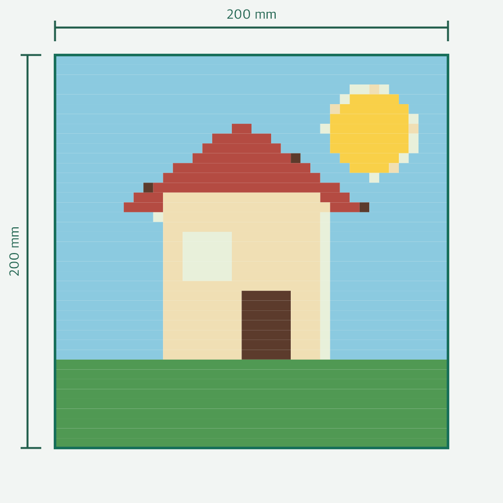
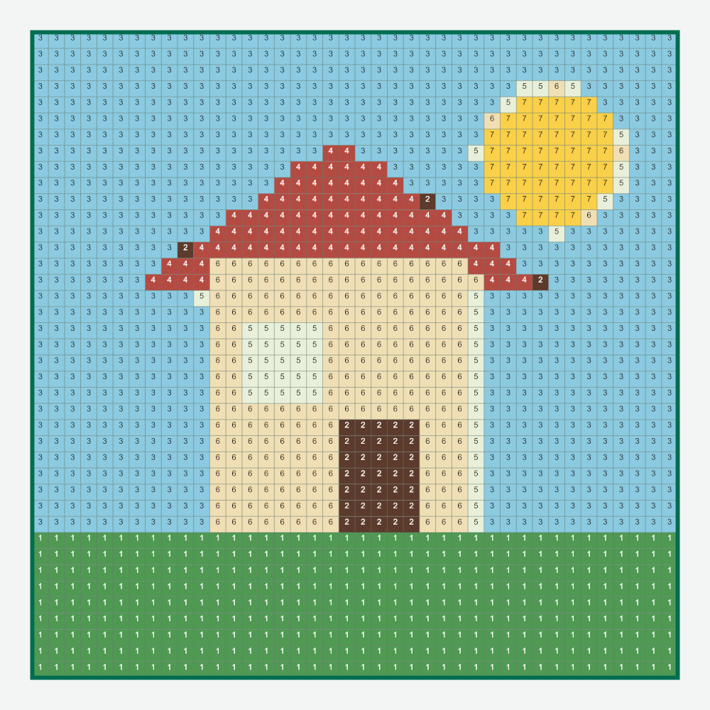
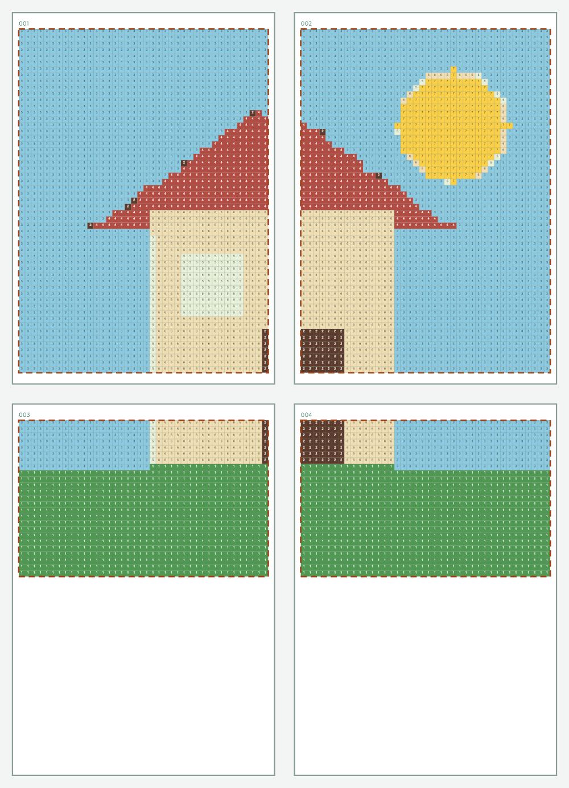
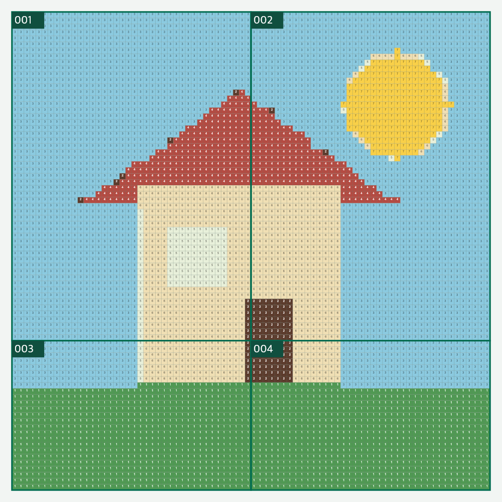

# いろさし

**写真から、色番号付きの図案・印刷用PDFを作成。**

## [いろさしを使う](https://higomon.github.io/irosashi/)

- **iPhone・パソコン対応／インストール不要**
- 仕上がり寸法・色数の調整
- **大きな図案のA4分割印刷**
- 写真の処理は端末内で完結

## 使用例

| 元の画像 | 図案の仕上がり |
| --- | --- |
|  |  |

- 仕上がり：200 × 200 mm
- 串の中心間隔：5 mm／40列 × 40行
- 使用色：7色

### 色番号付き図案

- 各マスに使用色の番号
- 材料表・図案・配置図のPDF出力

### A4分割印刷

- **400 × 400 mmの図案 → A4縦4枚**
- 配置：2列 × 2行／余白：5 mm
- 図案4枚＋材料表／別PDFの配置図

| A4に分割した4枚 | 貼り合わせ後 |
| --- | --- |
|  |  |

1. 用紙「A4」→「分割を見る」
2. PDFを保存 → **実際のサイズ（100%）で印刷**
3. 白い余白の切り取り
4. 番号順に配置 → **紙を重ねず、端同士で貼り合わせ**

## 使い方

1. 写真の選択（[お試し画像](docs/examples/sample.png)）
2. 寸法・串の間隔・色数の調整
3. 用紙・余白・分割の確認
4. PDFの保存・印刷

- 串の直径・中心間隔：実測値を入力
- iPhoneのPDF保存：「共有して保存」→「ファイルに保存」

## 編集・更新

- 編集元：`いろさし - 図案を作る.html` の1ファイル
- `main` へのpushでGitHub Pagesに自動公開
